<div align="center">




<br/>

[](https://github.com/nihcoc)
[](https://www.instagram.com/alf.rde/)

</div>


## `> Currently working on`

### [PeriR](https://github.com/nihcoc/PeriR)

Software-defined radio for the Raspberry Pi CM4, built around an Artix-7 50T FPGA and the AD9364 RF transceiver, with PCIe 2.0 support.

```
 AD9364 RF ──── data ────▶ Artix-7 50T ──── PCIe 2.0 ────▶ RPi CM4
 transceiver               FPGA / DSP                       host
```

     

### STMflow

STM32-based reflow oven controller.

```
 temp ▲
      │            ▄▄▄ peak ▄▄▄
      │          ▄▀             ▀▄
      │   soak ▄▀                 ▀▄ cool
      │  ▄▄▄▄▀
      └──────────────────────────────▶ time
```

 

## `> What I've completed`

### [EchoSign](https://github.com/nihcoc/EchoSign)

Wearable glove that translates hand gestures into text and speech.


    

### [WCIS](https://github.com/nihcoc/WCIS)

ESP32-based irrigation controller with a custom enclosure and plumbing integration.

     

### [PCBCLOCK](https://github.com/nihcoc/PCBCLOCK)

STM32-based LED-matrix analog clock with a 32.768 kHz TCXO.

   

<div align="center">


</div>
